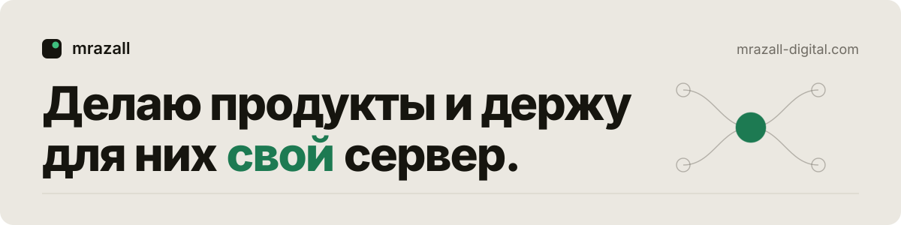

<a href="https://mrazall-digital.com">
  <picture>
    <source media="(prefers-color-scheme: dark)" srcset="assets/banner-dark.svg">
    
  </picture>
</a>

Делаю продукты целиком, от интерфейса до железа в стойке: веб и мобильные приложения, бэкенд, свои серверы.

**[mrazall-digital.com](https://mrazall-digital.com)** · Telegram **[@rematill](https://t.me/rematill)**

### Запущено

**[Мой час](https://myhouronline.ru)** — рабочее место частного репетитора: урок на общей доске со звонком, календарь, оплаты. Ученику нужна только ссылка, данные шифруются на устройстве.

**[Кофе он мой](https://xn--i1afcdc.xn--p1ai)** — цифровая карта лояльности московской кофейни, без регистрации и без сервера.
[RuStore](https://www.rustore.ru/catalog/app/ru.kofeonmoy.loyalty) · [Google Play](https://play.google.com/store/apps/details?id=ru.kofeonmoy.loyalty)

**[AI Development Hub](https://github.com/mrazall/ai-development-hub)** — пульт для ИИ-агентов, которые пишут код: Claude Code и Codex на своих машинах, сессии вживую, задачи по веткам git, память в Obsidian. Открытый код, Apache-2.0.

### Для себя

Домашний сервер: медиатека на Jellyfin с мини-приложением в Telegram, своя музыкальная библиотека, модовые серверы Minecraft для друзей, 12 ТБ хранилища с ежедневными бэкапами. Подробнее — [на сайте](https://mrazall-digital.com/#self).

TypeScript · Python · React · FastAPI · Android · Docker · Linux
